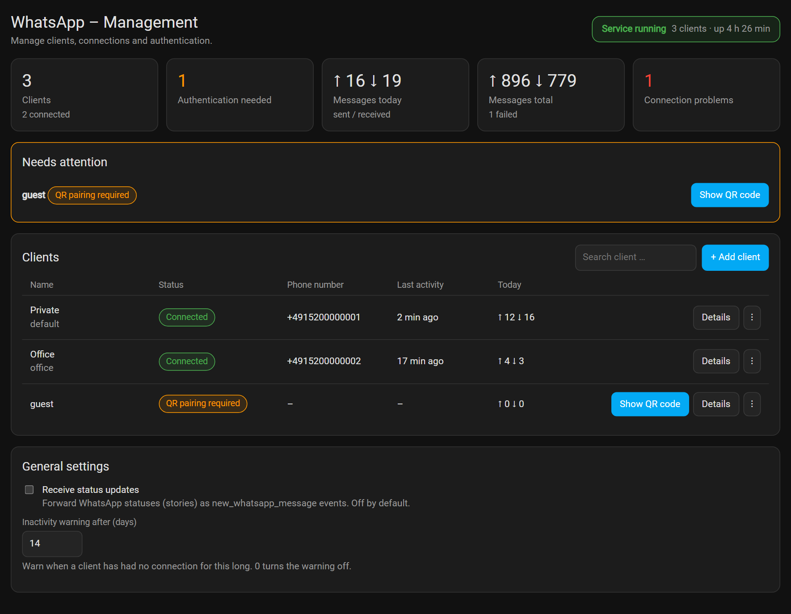
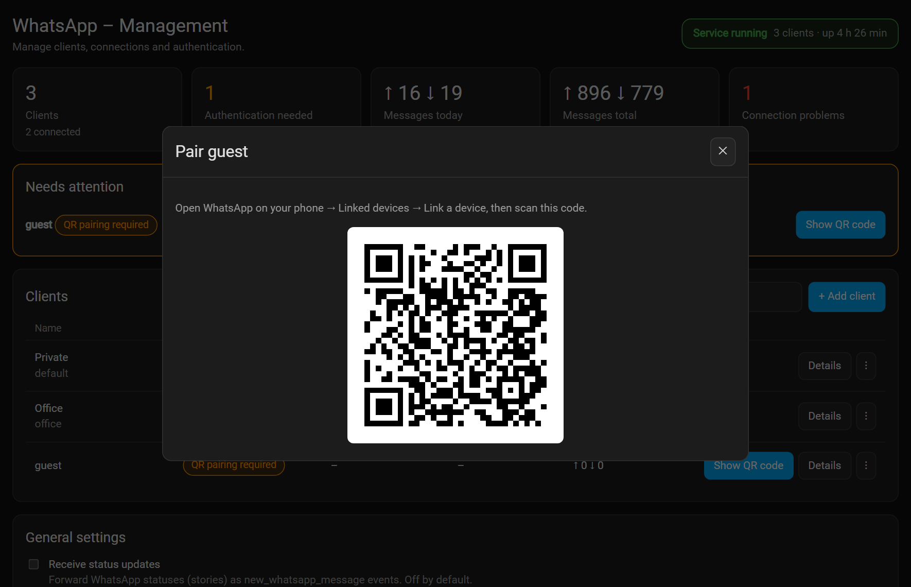
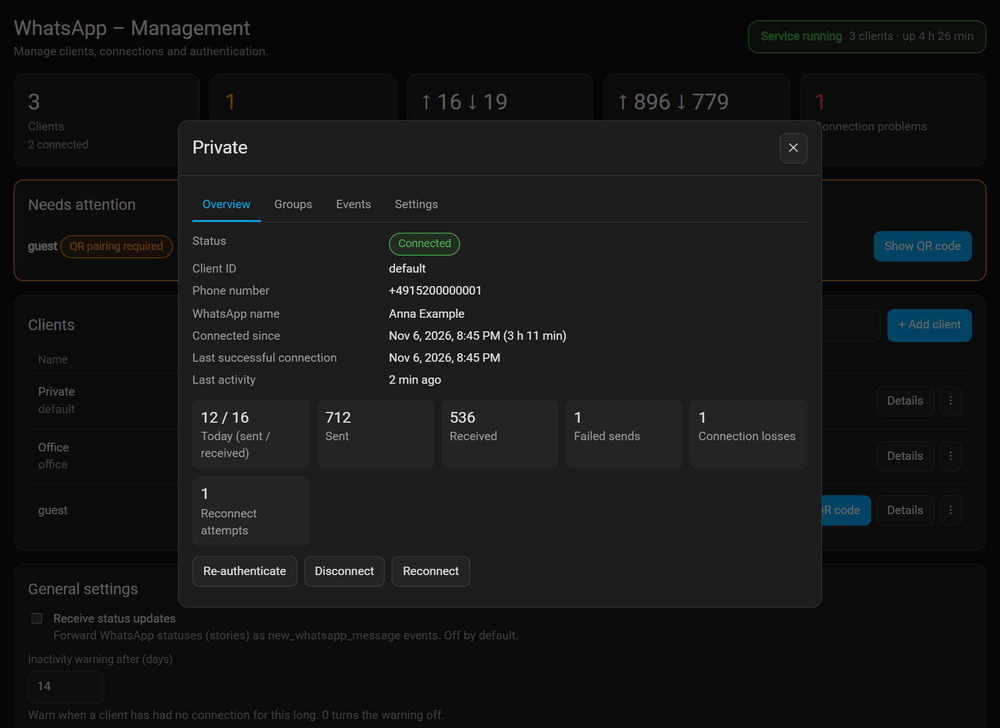
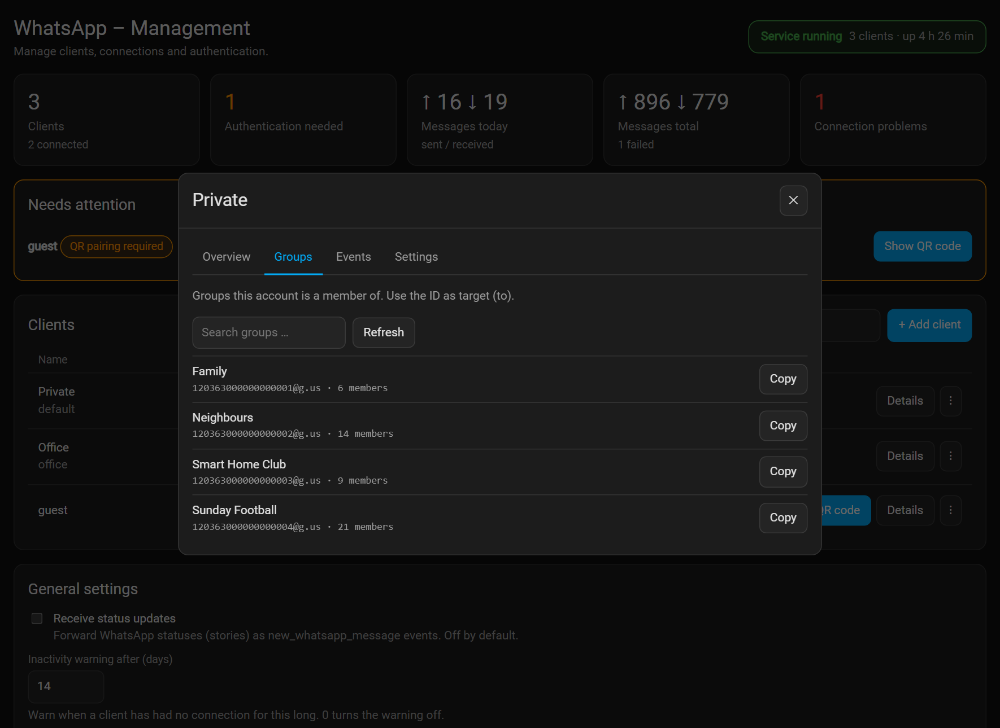
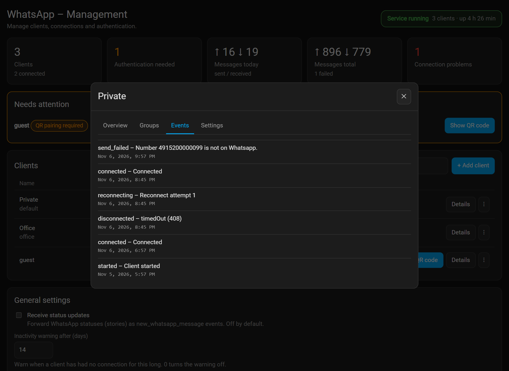
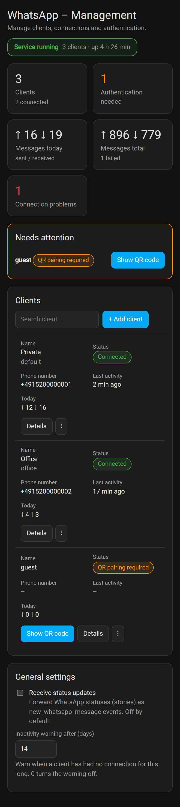

> ⚠️ This is a personal fork of the original WhatsApp add-on for Home Assistant by [Giuseppe Castaldo](https://github.com/giuseppecastaldo).
> Please refer to the [original repository](https://github.com/giuseppecastaldo/ha-addons/tree/main) for upstream changes.

**Buy Me a Coffee – Original Author:**

[](https://www.buymeacoffee.com/zkfpkdwyhyq)

Original repo: <https://github.com/giuseppecastaldo/ha-addons/tree/main>

# Home Assistant Add-on: Whatsapp add-on

_Send and receive WhatsApp messages from Home Assistant – with a management panel in the sidebar._


![Supports aarch64 Architecture][aarch64-shield]
![Supports amd64 Architecture][amd64-shield]
![Supports armhf Architecture][armhf-shield]
![Supports armv7 Architecture][armv7-shield]
![Supports i386 Architecture][i386-shield]

[aarch64-shield]: https://img.shields.io/badge/aarch64-yes-green.svg
[amd64-shield]: https://img.shields.io/badge/amd64-yes-green.svg
[armhf-shield]: https://img.shields.io/badge/armhf-yes-green.svg
[armv7-shield]: https://img.shields.io/badge/armv7-yes-green.svg
[i386-shield]: https://img.shields.io/badge/i386-yes-green.svg

A WhatsApp API client that connects as a linked device (like WhatsApp Web).

**NOTE:** I can't guarantee you will not be blocked by using this method, although it has worked for me. WhatsApp does not allow bots or unofficial clients on their platform, so this shouldn't be considered totally safe.



_Screenshots show made-up demo data._

## Features

- **Services** to send text, images, audio, locations and reactions, to users and groups (`whatsapp.send_message`, `set_status`, presence services, `get_groups`).
- **Events** for received messages (`new_whatsapp_message`, with the group name for group messages) and presence updates, to trigger automations and Node-RED flows.
- **Management panel** in the Home Assistant sidebar: add, rename, enable/disable, connect/disconnect, re-authenticate and remove clients **without restarting** the add-on.
- **Several WhatsApp numbers** side by side; re-authenticating one does not disturb the others.
- **Real session states** (connected, reconnecting, QR needed, authentication invalid, …) and persistent counters per client. No message contents are stored.
- **Group list** per client with copy-able group IDs.
- Status updates (stories) do **not** trigger message automations (can be enabled).
- Failed service calls show a clear error in Home Assistant.
- German and English panel.

|  |  |
| --- | --- |
|  |  |
|  |  |

On a phone:



## Installation

You need Home Assistant OS or Supervised (add-ons).

1. Add this repository to the add-on store (Settings → Add-ons → Add-on Store → ⋮ → Repositories):

   ```
   https://github.com/ConstableW/ha-whatsapp
   ```

2. Install and **start** the **Whatsapp** add-on. On every start it copies its integration to `/config/custom_components/whatsapp`.
3. **Restart Home Assistant**, then add this line to `configuration.yaml`:

   ```yaml
   whatsapp:
   ```

4. **Restart Home Assistant again.** The service `whatsapp.send_message` now exists.
5. Open **WhatsApp** in the sidebar, click **Show QR code** for the client `default` and scan it in WhatsApp (_Settings → Linked devices → Link a device_).

## Quick start

```yaml
service: whatsapp.send_message
data:
  clientId: default
  to: 391234567890@s.whatsapp.net # user: number@s.whatsapp.net, group: id@g.us
  body: Hello from Home Assistant
```

Group IDs are shown in the panel (client details → **Groups**). The full reference – services, events, options, troubleshooting, sample automations and Node-RED – is in the [documentation](whatsapp_addon/DOCS.md).

## Updating

Restart Home Assistant once after each add-on update so the updated integration is loaded. Version 2.0 needs no migration: existing clients keep their sessions. See [Upgrading from 1.x](whatsapp_addon/DOCS.md#upgrading-from-1x) and the [changelog](whatsapp_addon/CHANGELOG.md).

## Development

```bash
cd whatsapp_addon
npm ci
npm test                        # unit and HTTP tests, no WhatsApp needed
node scripts/dev-ui.js          # panel with demo data on http://localhost:3100
node scripts/screenshots.js     # regenerate docs/images (needs Chrome or Edge)
```

See [TESTING.md](whatsapp_addon/TESTING.md) for the checklist that needs a real Home Assistant.

---

**Support & Issues:**
For support, feature requests or bug reports, please open an issue in the [GitHub repository](https://github.com/ConstableW/ha-whatsapp/issues).

We welcome community contributions and feedback!

Buy Me a Coffee – Maintainer:

[](https://www.buymeacoffee.com/constablew)
