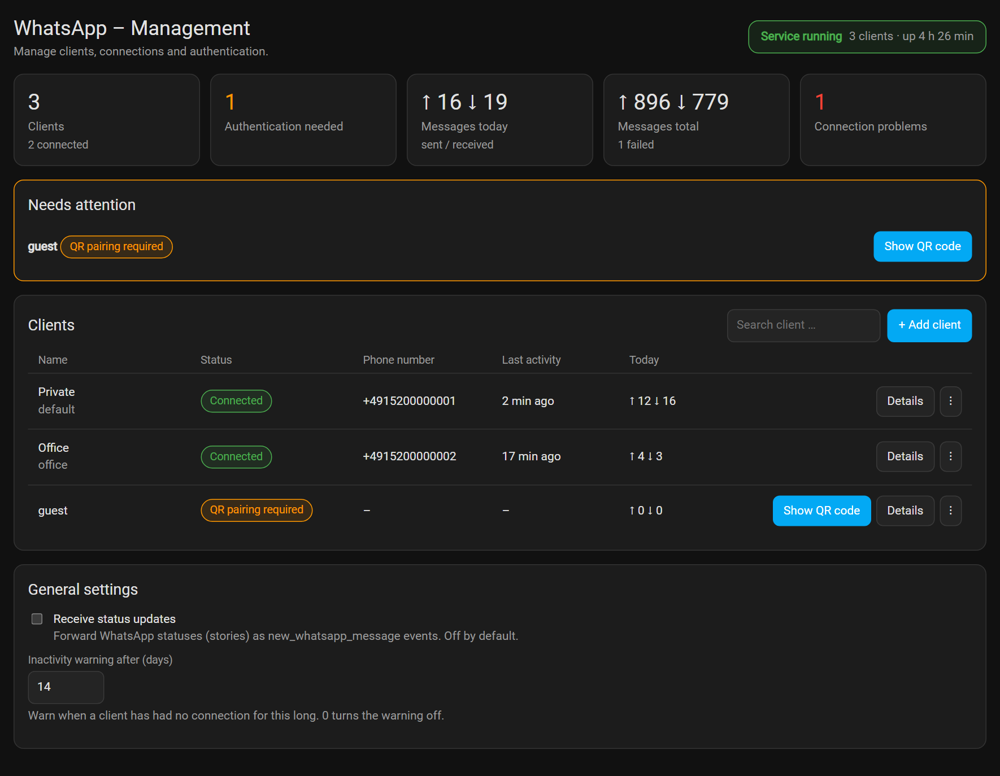
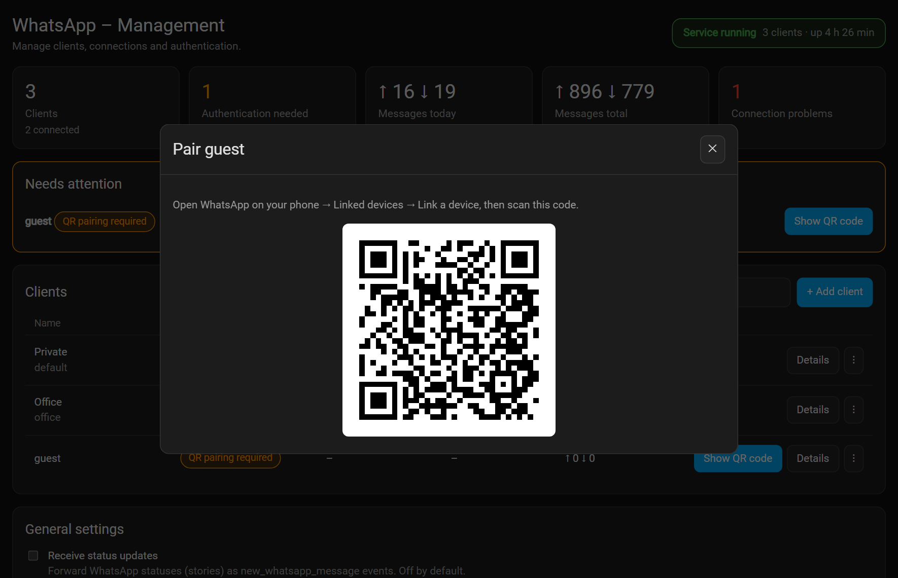
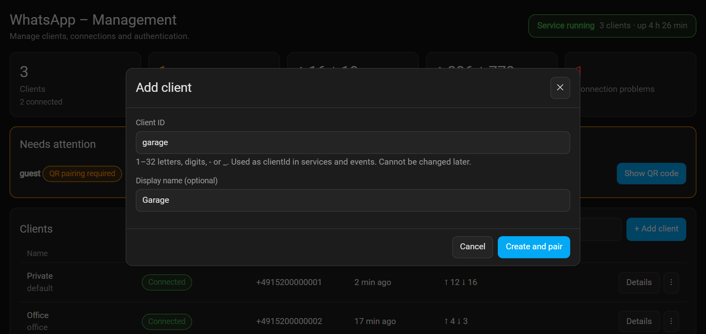
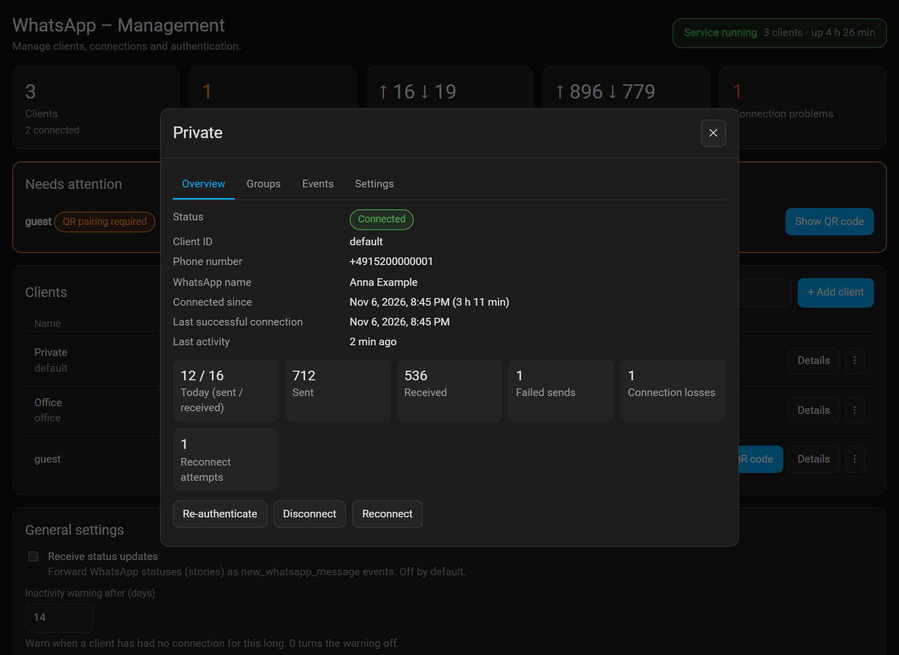
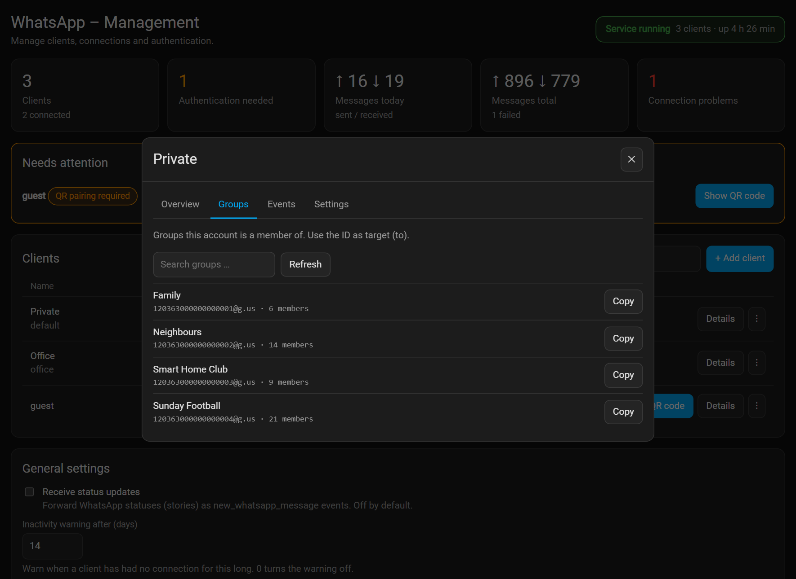
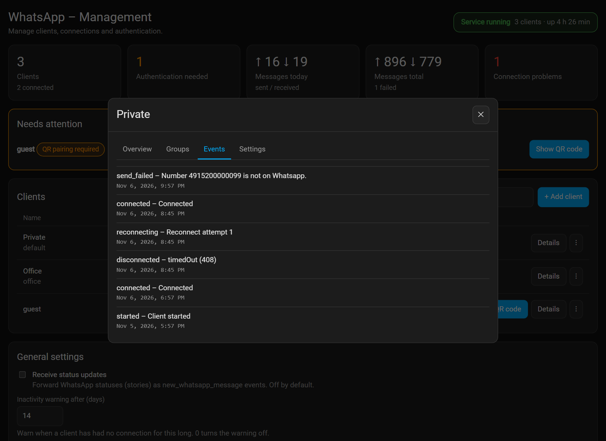

# Home Assistant Add-on: Whatsapp add-on

**Forked from [giuseppecastaldo/ha-addons](https://github.com/giuseppecastaldo/ha-addons/tree/main/whatsapp_addon)
Maintained by [ConstableW/ha-whatsapp](https://github.com/ConstableW/ha-whatsapp/tree/main/whatsapp_addon)**

Send and receive WhatsApp messages from Home Assistant. The add-on connects as a _linked device_ (like WhatsApp Web), exposes Home Assistant services and events, and has its own management panel in the sidebar.

> **Note:** WhatsApp does not allow bots or unofficial clients. Use a number you can afford to lose, and keep the traffic moderate.

## Contents

- [Setup](#setup)
- [The WhatsApp panel](#the-whatsapp-panel)
- [Options](#options)
- [Targets: users and groups](#targets-users-and-groups)
- [Services](#services)
- [Events](#events)
- [Errors](#errors)
- [Sample automations](#sample-automations)
- [Usage in Node-RED](#usage-in-node-red)
- [Data, privacy and security](#data-privacy-and-security)
- [Troubleshooting](#troubleshooting)
- [Upgrading from 1.x](#upgrading-from-1x)

## Setup

1. Install and **start** the add-on. On every start it copies its Home Assistant integration to `/config/custom_components/whatsapp`.
2. **Restart Home Assistant** (Settings → System → Restart).
3. Add this line to `configuration.yaml`:

   ```yaml
   whatsapp:
   ```

4. **Restart Home Assistant again.** The services `whatsapp.send_message` and friends now exist.
5. Open the **WhatsApp** entry in the sidebar. A client called `default` is created for you. Click **Show QR code** and scan it in WhatsApp on your phone: _Settings → Linked devices → Link a device_.

The status of the client changes to **Connected** and shows the phone number. After an update of the add-on, restart Home Assistant once so the updated integration is loaded.

## The WhatsApp panel

The add-on adds a **WhatsApp** entry to the Home Assistant sidebar (via Ingress, visible to administrators only).



What you can do there:

- see every client with its real connection state, phone number, last activity and today's messages,
- **add**, **rename**, **enable/disable**, **connect/disconnect** and **remove** clients without restarting the add-on,
- **pair** a client with a QR code, and **re-authenticate** it while the other clients keep running,
- list the **groups** a client is a member of and copy their IDs,
- read a small **event log** per client,
- change the general settings (status updates, inactivity warning).

The panel works on phones, too.

### Pairing a client



Use **+ Add client**, choose a Client ID (and optionally a display name) and scan the QR code. The ID is what you use as `clientId` in services and events, and it cannot be changed later. The display name can.



You can use several clients (several WhatsApp numbers) side by side. A persistent notification with the QR code is created as well, as in earlier versions.

### Client details



- **Overview** – state, phone number, WhatsApp name, connected since, last successful connection, last activity, counters, and the actions _Re-authenticate_, _Disconnect_, _Reconnect_.
- **Groups** – all groups of this account with their ID. Use _Copy_ and paste the ID as `to`.

  

- **Events** – connects, connection losses, reconnect attempts, logouts and failed sends with the reason.

  

- **Settings** – display name, enable/disable, and **Remove client**.

### Client states

The states come from the real WhatsApp connection events. The panel never shows a made-up session expiry.

| State                           | Meaning                                                                                       |
| ------------------------------- | --------------------------------------------------------------------------------------------- |
| Connected                       | The session is active.                                                                        |
| Connecting                      | The client is starting.                                                                       |
| Temporarily disconnected        | The connection dropped; a reconnect follows automatically.                                    |
| Reconnecting                    | A reconnect attempt is running.                                                               |
| QR pairing required             | The client was never paired (or was re-authenticated). Scan the QR code.                      |
| Authentication invalid          | WhatsApp logged the session out (for example the device was removed on the phone). See below. |
| Disabled                        | The client is switched off. Its session is kept.                                              |
| Disconnected (manual)           | You disconnected it. It connects again after an add-on restart or with _Connect_.             |

**After a logout** the client stays on _Authentication invalid_ until you click **Re-authenticate**. It does not start a new pairing by itself, and a persistent notification tells you about it.

**Re-authenticate** discards the current session (the device is unlinked from WhatsApp) and starts a new pairing. Other clients are not affected.

**Remove client** removes it from the configuration, unlinks the device, and deletes its session and statistics. You have to type the Client ID to confirm. This cannot be undone.

### Counters and the inactivity warning

Per client the add-on counts received messages, sent messages, failed sends, connection losses and reconnect attempts. "Sent" counts messages sent through this add-on, not messages you write on your phone. The counters survive restarts. Only numbers and timestamps are stored, **never message contents**.

The inactivity warning appears when a client has had no connection for a number of days (default 14, `0` turns it off).

## Options

The client list is stored in the add-on configuration, so the configuration page and the panel always show the same clients. Changes you make in the panel are written there.

| Option                      | Description                                                                                                                                  |
| --------------------------- | -------------------------------------------------------------------------------------------------------------------------------------------- |
| `clients`                   | List of client IDs. Add clients here or in the panel.                                                                                        |
| `disabled_clients`          | Managed by the panel. Listed clients are not connected.                                                                                      |
| `client_labels`             | Managed by the panel. Display names as `id=Name`.                                                                                            |
| `receive_status`            | Default `false`. WhatsApp status updates (stories) are **not** forwarded as `new_whatsapp_message`. Set to `true` to receive them.           |
| `inactivity_warning_days`   | Default `14`. The panel warns when a client had no connection for this many days. `0` turns it off.                                          |

## Targets: users and groups

The target of a message is the `to` field.

- **Users:** country code + number + `@s.whatsapp.net`. For the Italian number _3456789010_ that is `393456789010@s.whatsapp.net`. A plain number such as `393456789010` or `+393456789010` works as well, the suffix is added for you.
- **Groups:** an ID ending in `@g.us`, for example `120363000000000001@g.us`. Find it in the panel (client details → **Groups** → _Copy_) or with the service `whatsapp.get_groups`.

## Services

All services take `clientId`. Failed calls raise an error in Home Assistant, see [Errors](#errors).

| Service                                | Fields                                                              | Description                                                         |
| -------------------------------------- | ------------------------------------------------------------------- | ------------------------------------------------------------------- |
| `whatsapp.send_message`                | `clientId`, `to`, `body`, `options` (optional)                      | Send a message.                                                     |
| `whatsapp.set_status`                  | `clientId`, `status`                                                | Set the profile status text.                                        |
| `whatsapp.presence_subscribe`          | `clientId`, `to` (alias `userId`)                                   | Receive presence updates of a contact.                              |
| `whatsapp.send_presence_update`        | `clientId`, `type`, `to` (optional)                                 | Send a presence once: `available`, `unavailable`, `composing`, `recording`, `paused`. |
| `whatsapp.send_infinity_presence_update` | `clientId`, `type`, `to` (optional)                               | Repeat a presence every 10 seconds.                                 |
| `whatsapp.get_groups`                  | `clientId`, `refresh` (optional)                                    | Returns the groups of the account. Use it with `response_variable`. |

### Send a simple text message

```yaml
service: whatsapp.send_message
data:
  clientId: default
  to: 391234567890@s.whatsapp.net
  body: Hi, it's a simple text message
```

`body` may also be an object, e.g. `body: { text: "Hi" }`. A plain string is shorthand for `{ text: ... }`.

In the visual editor `body` is a text field. For everything else (images, audio, location, reactions) switch to **YAML mode** and pass an object.

### How to send an image

`caption` is a sibling of `image`, not part of it.

```yaml
service: whatsapp.send_message
data:
  clientId: default
  to: 391234567890@s.whatsapp.net
  body:
    image:
      url: "https://dummyimage.com/600x400/000/fff.png"
    caption: Simple text
```

The add-on downloads the image itself, so the URL must be reachable from the add-on container. A local file below `/media` works as well, e.g. `url: /media/picture.jpg`.

### How to send audio message

```yaml
service: whatsapp.send_message
data:
  clientId: default
  to: 391234567890@s.whatsapp.net
  body:
    audio:
      url: "https://github.com/ConstableW/ha-whatsapp/raw/main/whatsapp_addon/examples/hello_world.mp3"
    ptt: true # Send audio as a voice message
```

### How to send a location

```yaml
service: whatsapp.send_message
data:
  clientId: default
  to: 391234567890@s.whatsapp.net
  body:
    location:
      degreesLatitude: 24.121231
      degreesLongitude: 55.1121221
```

### How to quote a message

```yaml
service: whatsapp.send_message
data:
  clientId: "{{ trigger.event.data.clientId }}"
  to: "{{ trigger.event.data.key.remoteJid }}"
  body: Got it
  options:
    quoted: "{{ trigger.event.data }}"
```

### How to list groups

```yaml
service: whatsapp.get_groups
data:
  clientId: default
response_variable: groups
# groups.groups -> [{ id: "120363000000000001@g.us", subject: "Family", participants: 6 }]
```

The result is cached for a minute. Set `refresh: true` to fetch it again.

### How to subscribe to presence updates

```yaml
service: whatsapp.presence_subscribe
data:
  clientId: default
  to: 391234567890@s.whatsapp.net
```

Presence updates arrive as the event `whatsapp_presence_update`. Contacts only report presence while you appear online, so send an infinity presence update first.

## Events

| Event type                 | Description                           |
| -------------------------- | ------------------------------------- |
| `new_whatsapp_message`     | A message was received                |
| `whatsapp_presence_update` | Presence of a contact in a chat changed |

### `new_whatsapp_message`

The event data is the received message (as delivered by WhatsApp) plus `clientId` and `type`:

```yaml
clientId: default
type: conversation # type of the message content (conversation, imageMessage, ...)
key:
  remoteJid: 120363000000000001@g.us # chat: user or group
  participant: 391234567890@s.whatsapp.net # sender, in groups
  fromMe: false
  id: 3EB0C1D2E3F4
pushName: Anna # display name of the sender
messageTimestamp: 1767700000
message:
  conversation: Hello!
groupName: Family # only for group messages
```

- Your own messages are not forwarded.
- **Status updates (stories) are not forwarded** unless `receive_status` is `true`. Protocol and key-exchange messages (no user content) are never forwarded.
- For group messages the event contains `groupName` with the group's name, so automations can tell groups apart: `{{ trigger.event.data.groupName }}`.
- For plain text the text is in `message.conversation`; some messages (replies, links) carry it in `message.extendedTextMessage.text`.

## Errors

If the add-on cannot execute a service call, the Home Assistant action **fails with an error message**. Use `continue_on_error: true` in automations or the error output of the Node-RED node to react to it.

| Message                                           | Cause                                                                                    |
| ------------------------------------------------- | ---------------------------------------------------------------------------------------- |
| `Client ID not found.`                            | `clientId` does not exist. Check the ID in the panel.                                    |
| `Client <id> is not running (<state>).`           | The client is disabled or manually disconnected.                                         |
| `Send message failed. Whatsapp disconnected error.` | The client is not connected right now (see its state in the panel).                    |
| `Number <n> is not on Whatsapp.`                  | The target number has no WhatsApp account.                                               |
| `WhatsApp add-on is not reachable`                | The add-on is stopped or restarting.                                                     |

## Sample automations

### Ping Pong

```yaml
alias: Ping Pong
description: ""
trigger:
  - platform: event
    event_type: new_whatsapp_message
condition:
  - condition: template
    value_template: "{{ trigger.event.data.message.conversation == '!ping' }}"
action:
  - service: whatsapp.send_message
    data:
      clientId: default
      to: "{{ trigger.event.data.key.remoteJid }}"
      body: pong
mode: single
```

### Only react to one group

```yaml
alias: Smart Home Club
trigger:
  - platform: event
    event_type: new_whatsapp_message
condition:
  - condition: template
    value_template: "{{ trigger.event.data.groupName == 'Smart Home Club' }}"
action:
  - service: notify.notify
    data:
      message: "{{ trigger.event.data.pushName }}: {{ trigger.event.data.message.conversation }}"
mode: queued
```

### Driving mode

```yaml
alias: Driving mode
description: ""
trigger:
  - platform: event
    event_type: new_whatsapp_message
condition: []
action:
  - service: whatsapp.send_message
    data:
      clientId: "{{ trigger.event.data.clientId }}"
      to: "{{ trigger.event.data.key.remoteJid }}"
      body: Sorry, I'm driving, I will contact you soon
      options:
        quoted: "{{ trigger.event.data }}" # Quote message
mode: single
```

### Message reaction

```yaml
alias: React to message
description: ""
trigger:
  - platform: event
    event_type: new_whatsapp_message
condition: []
action:
  - service: whatsapp.send_message
    data:
      clientId: "{{ trigger.event.data.clientId }}"
      to: "{{ trigger.event.data.key.remoteJid }}"
      body:
        react:
          text: "👍🏻" # Use an empty string to remove the reaction
          key: "{{ trigger.event.data.key }}"
mode: single
```

### Presence notify (SUBSCRIBE FIRST!)

```yaml
alias: Presence notify
description: ""
trigger:
  - platform: event
    event_type: whatsapp_presence_update
    event_data: {}
condition:
  - condition: template
    value_template: "{{ trigger.event.data.presences['391234567890@s.whatsapp.net'].lastKnownPresence == 'available' }}"
action:
  - service: persistent_notification.create
    data:
      message: Contact is online!
mode: single
```

## Usage in Node-RED

Use a `call service` node (`whatsapp.send_message`) with a JSONata data field:

```json
{
  "clientId": "default",
  "to": $exists(to) ? to : $env("to"),
  "body": { "text": payload }
}
```

Image with caption:

```json
{
  "clientId": "default",
  "to": $env("to"),
  "body": {
    "image": { "url": $env("image") },
    "caption": $env("caption")
  }
}
```

Receive messages with an `events: all` node (event type `new_whatsapp_message`).

## Data, privacy and security

- **Sessions** are stored in `/data/<clientId>/` inside the add-on. They are included in Home Assistant backups of the add-on. Anyone with that data can use the WhatsApp session, so protect your backups.
- **Statistics** (counters, timestamps, the event log) are stored in `/data/stats.json`. Message contents are never stored.
- **The panel and its API** (`/admin/...`) only accept connections from the Supervisor's ingress proxy, i.e. after a Home Assistant login, and the sidebar entry is for administrators only. The accepted address is the Supervisor's well-known internal address plus whatever the hostname `supervisor` resolves to inside the add-on network.
- **The service endpoints** used by the Home Assistant integration (`/sendMessage` etc., port 3000) are reachable inside the internal add-on network without authentication, as in earlier versions. The port is not published to your network.

## Troubleshooting

**The services do not exist.** Check that `whatsapp:` is in `configuration.yaml` and that Home Assistant was restarted after the add-on had started once. Home Assistant has to be restarted again after each add-on update.

**No QR code.** Open the panel and click **Show QR code**. The code refreshes by itself while the dialog is open. If the client shows _Authentication invalid_, click **Re-authenticate** first.

**The panel shows an error "Could not save the add-on configuration".** The add-on could not write its options through the Supervisor. Nothing was changed. Check the add-on log and try again.

**The panel answers 403.** Open it through the sidebar entry (Ingress), not through `http://<host>:3000`.

**The client says _Authentication invalid_.** WhatsApp ended the session, for example because the device was removed under _Linked devices_ or the phone had no connection for a long time. Click **Re-authenticate** and scan the new QR code.

**Messages from statuses trigger my automation.** Update to 1.6.2 or later. Statuses are filtered unless `receive_status` is enabled.

**Where do I find a group ID?** Panel → client details → **Groups**, or the service `whatsapp.get_groups`.

**A number is "not on WhatsApp".** Use the full international number without leading zeros, for example `4915112345678`.

## Upgrading from 1.x

Version 2.0 needs no migration. Existing clients keep their sessions, you do not have to pair again, and the services work as before. New optional options were added (`disabled_clients`, `client_labels`, `receive_status`, `inactivity_warning_days`). After the update restart Home Assistant once so the updated integration is loaded.

Changes in behavior:

- Status updates no longer fire `new_whatsapp_message` (turn them back on with `receive_status`).
- A failed service call now fails the Home Assistant action instead of silently doing nothing.
- After a logout from WhatsApp the add-on no longer starts a new pairing by itself. Use **Re-authenticate** in the panel.

## Support & Issues

For support, feature requests or bug reports, please visit the [GitHub repository](https://github.com/ConstableW/ha-whatsapp/tree/main/whatsapp_addon).

---

**Thank you for using this add-on!**
