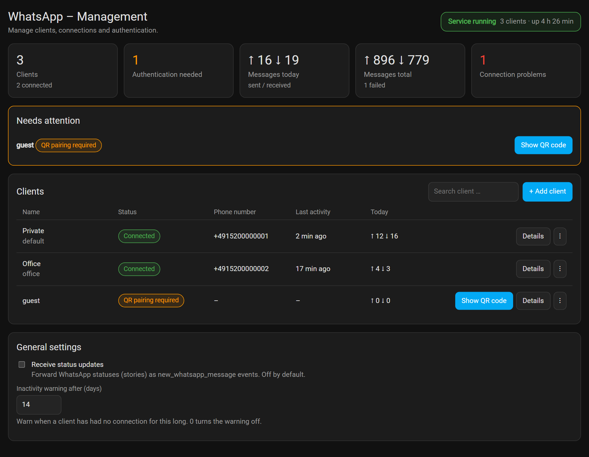

Buy Me a Coffee – Original Author:
[](https://www.buymeacoffee.com/zkfpkdwyhyq)

# Home Assistant Add-on: Whatsapp add-on

_Send and receive WhatsApp messages from Home Assistant – with a management panel in the sidebar._


![Supports aarch64 Architecture][aarch64-shield]
![Supports amd64 Architecture][amd64-shield]
![Supports armhf Architecture][armhf-shield]
![Supports armv7 Architecture][armv7-shield]
![Supports i386 Architecture][i386-shield]

[aarch64-shield]: https://img.shields.io/badge/aarch64-yes-green.svg
[amd64-shield]: https://img.shields.io/badge/amd64-yes-green.svg
[armhf-shield]: https://img.shields.io/badge/armhf-yes-green.svg
[armv7-shield]: https://img.shields.io/badge/armv7-yes-green.svg
[i386-shield]: https://img.shields.io/badge/i386-yes-green.svg

A WhatsApp API client that connects as a linked device (like WhatsApp Web).

**NOTE:** I can't guarantee you will not be blocked by using this method, although it has worked for me. WhatsApp does not allow bots or unofficial clients on their platform, so this shouldn't be considered totally safe.



_Screenshots show made-up demo data._

## Features

- Services to send text, images, audio, locations and reactions to users and groups.
- Events for received messages (with the group name) and presence updates.
- Management panel in the sidebar: add, rename, enable/disable, connect/disconnect, re-authenticate and remove clients without restarting the add-on.
- Several WhatsApp numbers side by side, real session states, persistent counters, list of groups.
- Status updates (stories) do not trigger message automations.

## Installation guide

1. Install and **start** this add-on. It copies its integration to `/config/custom_components/whatsapp`.
2. **Restart Home Assistant**, then add this to `configuration.yaml`:

   ```yaml
   whatsapp:
   ```

3. **Restart Home Assistant again.** You will now see the service `whatsapp.send_message`.
4. Open **WhatsApp** in the sidebar, click **Show QR code** for the client `default` and scan it with the WhatsApp mobile app (_Settings → Linked devices → Link a device_).

Restart Home Assistant once after each add-on update. The **Documentation** tab describes the panel, all services and events, and troubleshooting.

---

**Support & Issues:**
For support, feature requests or bug reports, please visit the [GitHub repository](https://github.com/ConstableW/ha-whatsapp/tree/main/whatsapp_addon).

Buy Me a Coffee – Maintainer:
[](https://www.buymeacoffee.com/constablew)
